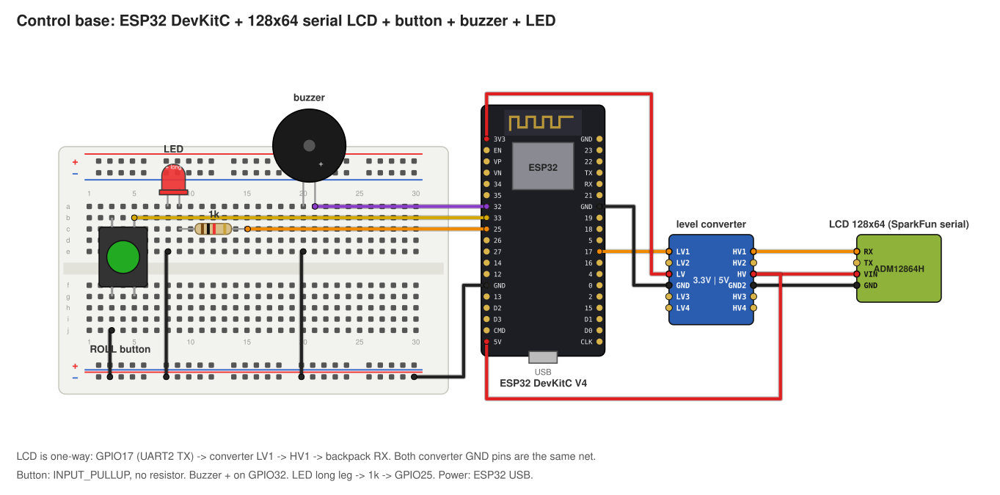
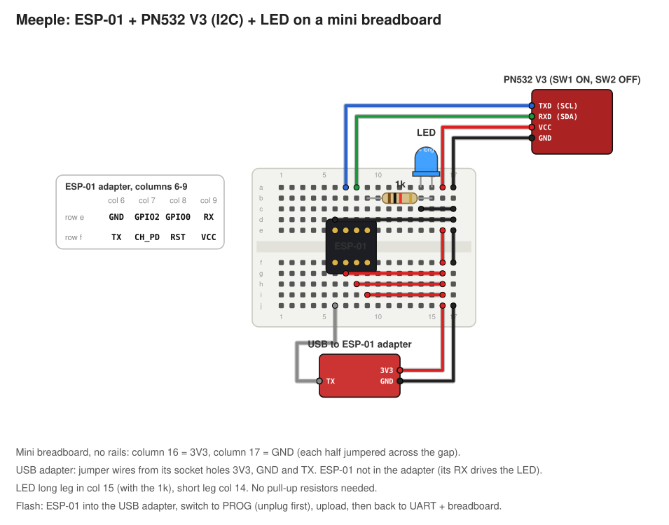

# Wiring

Firmware is one PlatformIO project in `firmware/` (open that folder in VS Code), with envs `base` and `meeple`. Diagrams are Wokwi `diagram.json` files:

- `firmware/diagrams/base/`: control base. The level converter and the serial LCD are custom wiring-only chips (`*.chip.json` / `*.chip.c`), so view it on wokwi.com like the meeple; the button, buzzer and LED part still match Wokwi parts.
- `firmware/diagrams/meeple/`: meeple, **wiring only**. Wokwi has no ESP8266/ESP-01, PN532 or USB adapter part, so these are custom chips (`*.chip.json` / `*.chip.c`) that only show pins. To view it, open a new project on wokwi.com and paste `diagram.json` plus the chip files.

`src/<env>/pins.h` must stay in sync with its diagram.

Both diagrams are generated by `firmware/diagrams/tools/layouts.py`, which places every part leg on a measured breadboard hole and routes every wire. `python3 layouts.py <out dir>` writes, per device, `<name>.diagram.json` (Wokwi), `<name>.svg` (the breadboard wiring sheet shown below, drawn by `tools/sheet.py` with the real ESP32 DevKitC pin order) and an HTML preview. Copy the `.diagram.json` and `.svg` into `diagrams/<name>/`. Hand edits get lost on the next regenerate.

## Control base (ESP32 DevKit)

One shared base for the whole table (lab kit p. 14–18).

| ESP32 pin | Connects to | Notes |
| --- | --- | --- |
| GPIO17 (UART2 TX) | level converter LV1 → HV1 → LCD backpack RX | one-way serial, 115200 baud |
| 3V3 | level converter LV | |
| 5V | level converter HV, LCD backpack VIN | the LCD runs on 5 V |
| GND.3 | level converter GND (both sides), LCD backpack GND | |
| GPIO33 | push button → GND | `INPUT_PULLUP` |
| GPIO32 | passive buzzer + | PWM (`tone()`), buzzer − to GND |
| GPIO25 | 1 kΩ → LED → GND | active high |
| GND.1 | breadboard bottom − rail | |

Display: ADM12864H 128x64 graphic LCD with a SparkFun Serial Graphic LCD backpack. The backpack's TX is not used. Text is 21 columns x 8 rows (6x8 font). If the lines come out in reverse order, flip `LCD_Y_FROM_TOP` in `src/base/glcd.cpp` (the text Y origin differs between backpack firmware versions).

## Meeple (ESP-01)

Follows the lab kit's proposed schema (`docs/LAB_Kit_2627.pdf`, p. 12).

Built on the kit's mini breadboard (17 columns, no power rails). The ESP-01 sits in its breadboard adapter across the center gap, columns 6–9: GND, GPIO2, GPIO0, RX on the top side (row e), TX, CH_PD, RST, VCC on the bottom side (row f). Column 16 is the 3V3 bus and column 17 the GND bus; each has a short jumper across the gap so both halves are connected. (Wokwi draws custom chips as a DIP, so on wokwi.com the ESP-01 wires don't line up; use the SVG.)

| ESP-01 pin | Connects to | Notes |
| --- | --- | --- |
| VCC | 3V3 rail | |
| GND | GND rail | |
| CH_PD (EN) | 3V3 rail (wire) | must be high to run |
| RST | 3V3 rail (wire) | |
| GPIO0 | PN532 SDA (labelled RXD) | no external pull-up: the ESP8266 internal pull-ups keep it high at boot and Wire enables INPUT_PULLUP |
| GPIO2 | PN532 SCL (labelled TXD) | same |
| GPIO3 (RX) | 1 kΩ → LED → GND | so Serial runs TX-only |
| TX | adapter socket TX hole | serial monitor only |

Power: the OPEN-SMART USB to ESP-01 adapter (powerbank or laptop USB), used only as a 3.3 V supply and serial monitor. The ESP-01 sits on the breadboard, **not** in the adapter: the adapter's CH340 drives the ESP's RX pin, which is the LED pin. Jumper the adapter socket's 3V3, GND and TX holes; leave the others empty.

- PN532 V3: mode switches SW1 = ON, SW2 = OFF (I2C). On our boards the I2C pins are labelled TXD/RXD: **RXD = SDA → GPIO0, TXD = SCL → GPIO2** (the opposite of some online pinouts).
- Flashing: put the ESP-01 in the adapter, slide its switch to PROG (unplug first), plug in, `pio run -e meeple -t upload`. Back to UART + breadboard to run.
